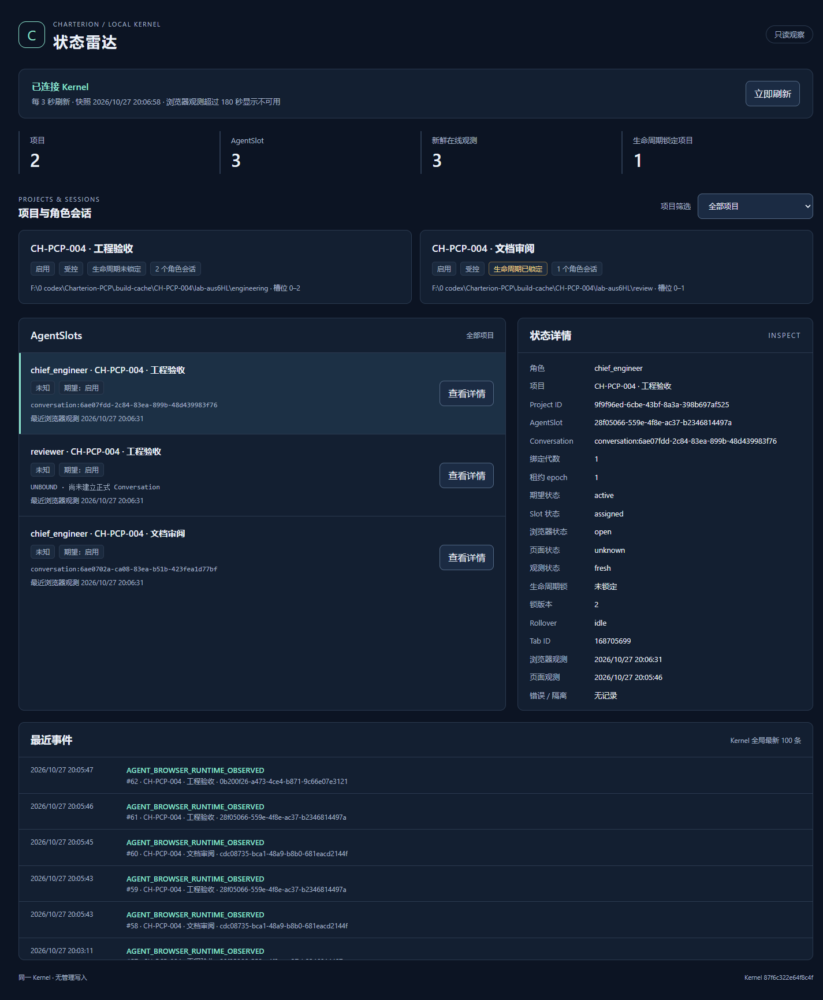
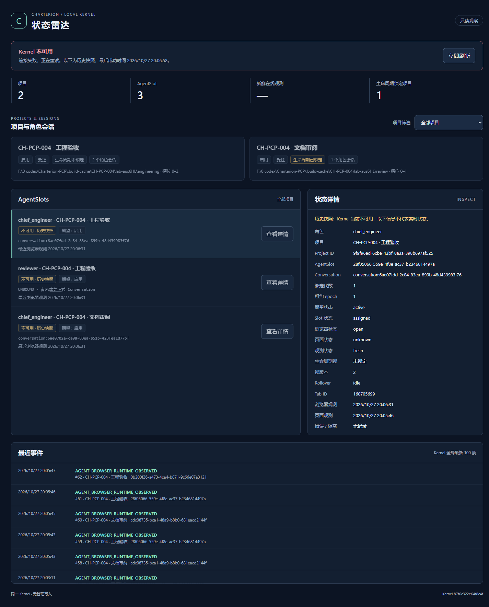

# CH-PCP-004：独立 HTML 状态雷达 MVP

输入：用户 CH-PCP-004，基于 Draft PR #6 `bea8fc14b813169d5487b42228598935edb30fc8`。仅实现本机只读展示、插件启动入口及隔离验证；不部署现有 Runtime、不接 CB、不开放管理写入、不合并 main。

## Architecture Gate（编码前完成）

治理依据：PCP 主仓 `67fdf81a50fdd90f9c67d90d2f08706c3b669abc` 的 `processes/architecture-governance-gate.md`、`processes/experience-reuse-gate.md`、PCP-01 V0.2 FIXED。仓库 V0.3 目标架构、实施验收 V0.2 和部署 V0.2 已批准同进程回环 HTTP 与独立页面边界，本工单进一步收窄为只读。

```yaml
architecture_gate:
  required: true
  status: complete
  real_use_evidence: verified
  decision: INTEGRATE
  pcp_specific_remainder: project/AgentSlot/Conversation/lock projection from the existing Kernel; explicit freshness and unavailable states
  minimum_formalization: thin optional in-process HTTP adapter and independent static HTML/CSS/JS; no new store, scheduler or core object
```

结构问题：在既有事实源旁提供经授权的只读观测窗口，避免监控页面成为第二套运行状态或写入权威。

Cross-Domain Scan: COMPLETE。

- 直接类比：[Prometheus query HTTP API](https://prometheus.io/docs/prometheus/latest/querying/api/) 展示查询返回和明确错误状态；借鉴读接口与展示分离，不引入指标数据库/监控集群。
- 相邻领域：[Node HTTP](https://nodejs.org/api/http.html) 已提供 HTTP 服务机制；复用标准库、同进程启动/关闭，无额外 Web 框架或后台服务。
- 结构类比：[CQRS](https://learn.microsoft.com/en-us/azure/architecture/patterns/cqrs) 区分查询和命令；只借鉴读投影边界，查询既有 Kernel，不建立另一套持久读模型或消息总线。
- 经验复用分类：PROJECT_LOCAL（既有仓库设计直接适用；PCP validated/candidates 定向搜索未发现需要另行引入的本机雷达实现）。未提升候选经验或修改上游治理。

Core-boundary impact: none。HTTP、认证和浏览器兼容性留在传输/界面边界。

实现约束：只绑定 127.0.0.1；可选端口；严格 GET allowlist，无通用 RPC 代理；独立进程期只读令牌，经已认证 Native/CLI 获取 URL，用 fragment 引导且立即移出地址栏；不在页面或 URL 暴露 admin/browser token。事件仅展示元数据，不返回任意 payload。跨站/错误 Host 被拒，无 CORS 开放。

## 实施及验证

实现为既有 `gamd` 内的可选 HTTP 适配器；数据库和 Kernel 仍是唯一事实源，无迁移、第二套存储或调度器。新增显式 DTO、字段白名单和静态 HTML/CSS/JS，构建产物位于 `dist-control/dashboard/`。事件仅返回 seq、project、type、subject、时间，不暴露 payload。原有事件游标读取保持升序，雷达显式请求最新 100 条。

页面展示项目、AgentSlot、角色、正式 Conversation 或 UNBOUND、期望/实际状态、绑定代数、租约、生命周期锁及最近事件。每 3 秒读取真实快照，支持手动刷新、项目筛选和状态详情。无浏览器观测、超过 180 秒的观测、Kernel 连接失败分别显示离线、观测过期/不可用和历史快照；断开后不继续展示在线计数。浏览器 error 优先于旧页面 idle 状态，避免误报绿色正常。用户字段用 textContent 渲染，未引入远程脚本、字体或 UI 框架。

插件工具栏动作和原 Side Panel 顶部的“打开控制台”共用 Native → Kernel `radar.open` → 普通 HTTP Tab 的启动路径；雷达没有嵌入 Side Panel。Native 生成契约增加一个只读发现方法，共 30 个方法。扩展校验 URL 必须为 127.0.0.1、HTTP、固定路径与只读 fragment。请求入口仍验证 extension sender。

## 启动及 API 契约

仅在**新的、已选定的 Kernel 实例**启动时设置 `GAM_RADAR_PORT`，未设置即关闭。`0` 分配随机端口，`1..65535` 指定端口。下例显式使用测试 home，不表示部署现有 Runtime：

```powershell
$env:GAM_HOME = 'F:\isolated-charterion-home'
$env:GAM_RADAR_PORT = '0'
node .\dist-control\gamd.cjs
# 另一终端使用相同 GAM_HOME，经认证获取当前进程只读 URL：
node .\dist-control\gamctl.cjs radar.open --admin --stdin
# stdin 输入 {}。不要将返回的只读 URL/令牌写入共享日志。
```

插件需要指向同一隔离实例的 Native Host。这里只说明启动协议，没有改写既有 Runtime 配置或全局环境。

| 路径 | 行为 |
| --- | --- |
| GET /pcp/、/pcp/radar.js、/pcp/radar.css | 固定静态资产白名单 |
| GET /pcp/api/snapshot | Bearer 只读令牌；返回当前 Kernel 快照 |
| GET /pcp/api/snapshot?projectId=ID | 单项目快照及该项目最新 100 条事件 |
| 非 GET | 405 READ_ONLY，无写入处理器 |
| 缺失/错误/其他进程期令牌 | 401 READ_SESSION_REQUIRED |
| 错误 Host、外站 Origin、cross-site 请求 | 403，无 CORS 授权 |
| 通用 RPC/文件读取等其他路径 | 404 |
| 非法筛选/重复参数 | 400；不存在的项目 404 |
| Kernel 读取异常 | 503 STATE_UNAVAILABLE，不返回异常堆栈 |

只读令牌在内存中生成，与 admin/browser token 分离；启动 URL 使用 fragment，页面立即移除 fragment，仅在当前 Tab 的 sessionStorage 保存。Kernel 重启令牌轮换，页面提示从插件重新打开。静态资源和 API 均 no-store，CSP 限制同源并禁止嵌入。监听 127.0.0.1，最大连接数 32。默认 HTTP 80 端口也规范化 origin，避免浏览器省略 `:80` 后 Host 校验失败。

## 实际验证结果

| 验证 | 结果 | 实际范围 |
| --- | --- | --- |
| npm run build | PASS | 扩展指纹 ad66bf685f749df1 |
| npm run build:control | PASS | Kernel/CLI/launcher 和独立 HTML 资产 |
| npm run build:native | PASS | 隔离便携 SDK 9.0.320；0 warning / 0 error；未安装系统 SDK |
| .NET publish | PASS | framework-dependent 隔离产物，未覆盖原 Native Host |
| npm run check、check:control | PASS | 扩展/页面与 Kernel 类型检查；Native 契约及路由校验 |
| npm run check:architecture、check:assets、check:dist | PASS | 未放宽边界/预算；background 925 行；指纹一致 |
| 新增雷达测试 | PASS | 2 文件、15 测试；HTTP/鉴权/只读/筛选/脱敏/新鲜度/UI/URL 边界 |
| 全量单元回归 | PASS | 84 文件、485 测试；含既有绑定、锁、迁移回归 |
| 真实 .NET Host → Kernel smoke | PASS | 新协议产物；读取、权限拒绝、首次绑定授权、拒绝自动/跨项目换绑、关闭重开、锁正反例；此 smoke 的浏览器观测为合成输入，单独标记，未计为 Chrome E2E |
| 真实 HTTP API 联调 | PASS | 200 读取、401 无令牌、405 写入拒绝、403 外站、404 通用 RPC 拒绝、项目隔离筛选 |
| 真实默认端口回归 | PASS | 新建隔离 Kernel 实际监听 127.0.0.1:80；静态页及鉴权 API 均 200，测试后关闭 |
| 真实 Chrome Extension → Native → HTML | PASS | Chrome for Testing 156.0.8078.47；实际点击扩展页按钮，创建独立 HTTP 页面并成功读取数据 |
| 浏览器筛选、详情、轮询 | PASS | 两项目/三槽位；CLI 实际修改项目锁后 1936ms 刷新到页面；另一个项目锁不变 |
| 真实 Kernel 断开及恢复 | PASS | 停止测试进程显示“Kernel 不可用”“历史快照”；重启旧令牌 401，插件重新打开恢复；绑定代数仍为 1 |
| 最终 UI 产物核对 | PASS | HTTP JS 与构建文件 SHA256 一致；375/768/1024/1440px 无横向溢出；正常/断开截图已目视检查 |

最终 UI JS SHA256：`66c773a3bb67c88cb07c1dd36a887ee3104eafb1ba854d478d9f017254d323e7`。本轮报告及截图记录的是当前工作树产物；提交仅增加版本标识，不另换产物。





联调数据由正式 CLI 写入本轮空白测试数据库，再由真实 HTTP 读取，没有用假 API/预设 JSON 冒充实时状态。两条 Conversation 引用来自 CH-PCP-003 的测试记录，另一个槽位未绑定；没有复制历史数据库、用户登录态或原 Chrome Profile。新 Chrome 中三个 ChatGPT 标签实际停在 Cloudflare“请稍候”页，扩展报告 browser=open、page=unknown。截图中的“新鲜在线观测 3”仅表示新鲜的浏览器打开观测，不证明 ChatGPT 登录、可发送或角色任务完成；槽位状态明确为“未知”。

主要原始记录保留于 Git 忽略的 `.build-cache/CH-PCP-004/`：`unit-final.log`、`targeted-final.log`、`check-final.log`、`native-smoke.log`、`browser-acceptance-final.log`、`final-ui-check.log`、`default-port-smoke.log`、`cleanup-receipt.json`。浏览器检查点与独立 home/profile/native 位于 `lab-aus6HL`。本轮没有将缓存、登录数据或令牌提交到 Git。

## 隔离恢复及剩余边界

测试使用独立 GAM_HOME、空白 Chrome Profile、独立扩展副本，以及创建前确认不存在的随机 Native Host 注册名。结束后原四个 HKCU Native Host 注册值与基线一致；本轮测试注册已删除，所有本轮 Chrome/Kernel 及测试监听端口已退出。原 Runtime PID 5980 持续存在，历史数据库长度 397312 与精确 mtime 保持一致。数据库检查是元数据核对，未声称具备测试前内容哈希。系统 `dotnet --list-sdks` 仍为空。

验证过程的失败日志保留：首次脚本等待日志的时序问题、扩展脚本尚未加载即点击，以及命令行加载的 unpacked 扩展 reload 后不再加载，均通过检查进程/脚本状态并完整重启本轮 Chrome 后继续，没有放宽产品鉴权。最终产物核对曾命中仍运行的旧测试 Kernel；确认监听端口归属后仅停止本轮旧进程并重新启动，最终 SHA 核对通过。清理脚本在已退出子进程上重复等待也已按所有权检查完成手动清理。这些失败不计为通过测试。

- NOT_RUN：既有 Runtime 的安装/覆盖/部署及原 Profile 联调；本工单明确不执行。
- NOT_RUN：物理点击 Chrome 工具栏图标；本轮 headless 浏览器实际点击的是扩展 UI 内入口，共用已验证的 openConsole 路径。
- BLOCKED：本轮空白 Profile 中新的已登录 ChatGPT 收发/会话 E2E，受 Cloudflare 验证限制；雷达链路和只读 API 不依赖绕过该验证。本轮未复用 CH-PCP-003 登录态，也未将其旧结果算作新 E2E。
- NOT_RUN：其他浏览器/操作系统、压力与并发规模验收、完整 Runtime 安装包 smoke。
- NOT_RUN：Hosted CI；仓库 Actions workflows 查询为 0，不将本地通过写成 CI 通过。
- MVP 限制：页面从 Kernel 全局最新 100 条事件中做项目筛选，标题已明确窗口范围；需要该项目更早记录时可用只读 API 的 projectId 参数。无历史翻页、事件正文、管理写入或任务调度功能。
- 安全边界：这是同一用户/本机实例的只读观察窗口，不提供多用户权限隔离；授权持有只读令牌者可读取该实例项目元数据。Kernel 重启或端口改变后需从插件重新打开。

```yaml
execution_evidence:
  workorder_profile:
    recommended_model: null
    recommended_reasoning_effort: null
  selected_execution:
    actual_model: gpt-6.1-sol
    actual_reasoning_effort: NOT_EXPOSED_BY_RUNTIME
  resolution:
    type: runtime_unobservable
    reason: workorder omits execution_profile; Tokdash exposes model but not actual effort or selection provenance
  requested_by: user CH-PCP-004
  resolved_by: Codex desktop runtime
  actor: Codex
```

Tokdash 会话 `01a17c6a-87b5-7641-8c5e-e7d170079b63` 覆盖 CH-PCP-001/002/003/004，标记 project-history-shared-session；任务收尾快照 tokens=33757413、token_events=236（20:07:36），属于共享会话统计，不归为 CH-PCP-004 独占用量。没有创建额外任务跟踪文件。完成本工单后停止，不启动下一阶段。
