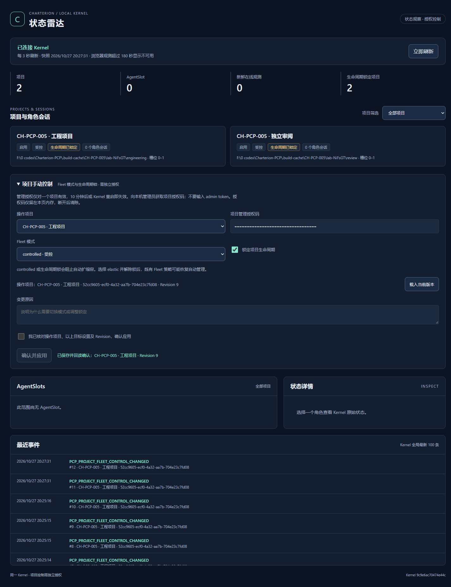
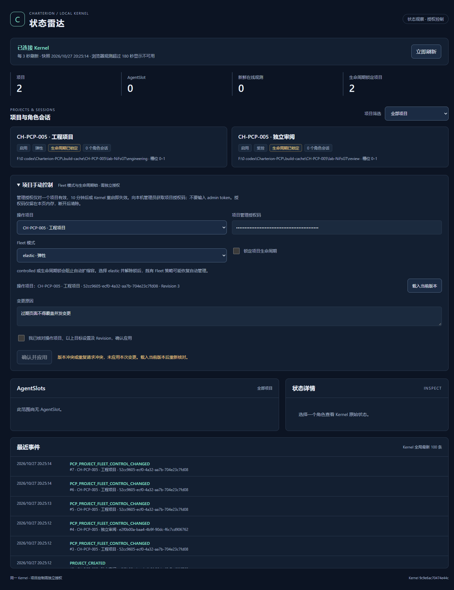

# CH-PCP-005：HTML 雷达手动控制

输入：用户 CH-PCP-005，基于 Draft PR #7 `1c40e9b1282bd9bb7c4fdd6c65a5cb35742de493`。范围仅项目 Fleet controlled/elastic 和生命周期锁；不接 CB、不改组织/任务系统、不部署既有 Runtime、不合并 main。

## Architecture Gate（编码前完成）

治理：PCP 主仓 `67fdf81a50fdd90f9c67d90d2f08706c3b669abc` 的 architecture-governance-gate、experience-reuse-gate、PCP-01 V0.2 FIXED、PCP_EXECUTION_PROFILE_RESOLUTION_BASELINE V0.1.1；本仓 V0.3 目标架构明确允许同进程 HTTP 控制，要求独立授权、确认、审计、版本校验及失败反馈。

```yaml
architecture_gate:
  required: true
  status: complete
  real_use_evidence: verified
  decision: INTEGRATE
  pcp_specific_remainder: project-scoped short-lived manual Fleet authorization at the existing HTTP boundary
  minimum_formalization: narrow in-memory capability and request receipts; existing Kernel CAS/audit/database remain authoritative
```

真实需要：CH-PCP-004 已完成实际只读页面/Native/Kernel 联调，手动控制现在仍需 CLI；用户本工单明确要求从该页面操作现有 Fleet 设置。结构问题是允许被单独授权的人在浏览器发出有限命令，而不让查询凭据提升为管理员权限。

Cross-Domain Scan: COMPLETE。

- 直接类比：[Kubernetes RBAC](https://kubernetes.io/docs/reference/access-authn-authz/rbac/) 按资源和操作收窄权限。这里只借鉴最小范围，复用现有 admin CLI 作为签发入口，不建设用户/RBAC 系统。
- 相邻领域：[OWASP CSRF 防护](https://cheatsheetseries.owasp.org/cheatsheets/Cross-Site_Request_Forgery_Prevention_Cheat_Sheet.html) 的精确 Origin、自定义头和非简单 JSON 写入；复用 Node HTTP 与原回环边界，不开放 CORS 或 Cookie 登录。
- 结构类比：[HTTP 条件请求](https://www.rfc-editor.org/rfc/rfc9110.html#name-if-match) 避免丢失更新；复用 Kernel 已有 expectedRevision 事务 CAS，HTTP 仅做映射。重复提交使用短期请求收据，重启后旧授权失效、持久 Revision 仍阻止重放变更。

经验分类 PROJECT_LOCAL：定向检索 approved governance、validated/candidates 未找到需要引入的另一套本机控制机制；直接扩展本仓已有 HTTP 适配器。Core-boundary impact: none。无新数据库、管理权威、调度器、组织或任务语义；授权和浏览器协议留在 Integration Boundary。

实施约束：只允许一个精确 Fleet POST；只读令牌与独立项目授权同时必需；管理员 CLI 签发 10 分钟项目授权，HTTP 无签发/通用 RPC；页面管理凭据仅内存、不进 URL/storage。actor 从签发记录取得，HTTP 不允许覆盖；原因必填，Revision 必填，错误/结果不明不假报成功、不自动重试。页面保留原视觉风格，复用 ui-ux-pro-max 的确认、禁用重复提交、就近反馈及可访问表单规则。

## 实施及验证

新增 `radarControl.ts` 仅负责项目授权和短期请求收据；实际写入直接调用现有公开 Kernel 接口 `setPcpProjectFleetControl`。该接口在既有 SQLite 事务中完成 Revision CAS、原因/actor 记录和 `PCP_PROJECT_FLEET_CONTROL_CHANGED` 审计。本轮未修改此 Kernel 接口、数据表、迁移、角色、组织或任务系统。

独立页面增加可折叠的项目手动控制表单，包含项目、Fleet 目标模式、生命周期锁、载入的 Revision、原因、项目授权码及确认勾选。控件有可见标签、44px 交互区域、键盘焦点和就近反馈；沿用 CH-PCP-004 视觉样式。未将管理授权放入插件 action/Native 协议或只读 URL。

## 授权及操作协议

1. 继续使用 `GAM_RADAR_PORT=0` 启动**独立测试 Kernel**，插件按原只读流程打开页面。默认未启用 HTTP 的实例仍不提供雷达或管理授权。
2. 本机管理员使用与目标实例一致的 GAM_HOME，通过现有 CLI 读取本机 admin 凭据并签发短期项目授权。浏览器无法签发，Native browser token、只读令牌及错误 instance 均被拒绝。
3. 将返回的 `fleet_` 开头授权码输入页面。该码只授权指定项目的 Fleet/生命周期锁，10 分钟失效；Kernel 重启也立即失效。actor 固定为签发记录，HTTP 不允许覆盖。页面只接受此格式，避免把普通读令牌或 admin token 当作管理授权发送。
4. 选择项目和目标设置，填写原因，勾选核对确认后提交。轮询不会修改表单已载入的 Revision；冲突后需显式“载入当前版本”再核对。
5. 成功响应后再单独 GET 真实快照；只有 Revision、模式、锁均与收据一致才显示“已保存并回读确认”。未变更设置显示未变，无新增审计。写后回读失败、响应不明或状态已被其他操作替换时都不报成功、不自动重试。

管理员命令示例（仅在已选定的独立实例中执行；不要把授权码或 URL 写入共享日志）：

```powershell
$env:GAM_HOME = 'F:\isolated-charterion-home'
@{ projectId = '<目标项目 ID>'; actor = '本机操作人' } |
  ConvertTo-Json -Compress |
  node .\dist-control\gamctl.cjs radar.authorize-control --admin --stdin
```

CLI 返回 token、projectId、actor、expiresAt。admin token 从 CLI 原有本地配置读取，既不返回给页面，也不在 HTTP 中接受。页面管理授权只在 password 输入框/请求闭包的内存中存在，不写 URL、sessionStorage、localStorage、Cookie；切换项目、Kernel 断开或授权拒绝时清空。只读查询凭据仍按原流程隔离。

| 边界 | 实际协议 |
| --- | --- |
| 唯一管理 HTTP 路径 | POST `/pcp/api/fleet-control`；不开放通用 RPC、签发、任务或其他控制项 |
| 必需身份 | 原只读 `Authorization: Bearer …` 加独立 `X-Charterion-Control: fleet_…`；两者缺一不可 |
| 站点限制 | 127.0.0.1、精确 Host、精确 Origin；若有 Sec-Fetch-Site 必须 same-origin；不允许 CORS |
| 输入限制 | 精确 application/json；8192 字节、5 秒请求体上限；严格字段白名单 |
| 写入字段 | projectId、mode、lifecycleLocked、expectedRevision、reason、requestId；actor 由授权记录提供 |
| 重复请求 | 相同授权/requestId/规范化内容返回原收据；同 ID 换内容 409；不重复写入或审计 |
| 范围/寿命/容量 | 单项目、10 分钟；最多 32 个存活授权，每个最多 128 个请求收据；达到上限明确拒绝，不驱逐仍有效的重放保护 |
| 持久权威 | 现有 Kernel CAS 和审计事务；无新数据库。收据/授权仅进程内存，重启不恢复授权；已提交 Revision 和锁继续持久存在 |

## 实际测试结果

| 检查 | 结果 | 实际证据 |
| --- | --- | --- |
| 扩展及 Kernel/CLI/HTML 构建 | PASS | `npm run build`、`npm run build:control`；扩展源码未变，原指纹 ad66bf685f749df1 保持 |
| .NET 构建 | PASS | 本轮便携 SDK 9.0.320 子进程构建，0 warning、0 error；系统未安装 SDK |
| 类型、契约、架构及资产 | PASS | check、check:control、check:architecture、check:assets、check:dist；未放宽预算，background 925 行 |
| 新增测试 | PASS | 2 文件、16 项：10 HTTP/授权/收据测试，6 表单反馈/回读测试 |
| 雷达针对性回归 | PASS | 4 文件、31 项，含此前只读和页面回归 |
| 最终全量单元测试 | PASS | 86 文件、501 项；最终源码 97.45 秒运行通过 |
| 本机授权/HTTP 联调 | PASS | 缺失读令牌 401、只读令牌写入 403、跨站 403、跨项目 403；所有负例均未改变目标 Revision |
| 真实 Chrome / Extension / Native / HTML | PASS | Chrome for Testing 156.0.8078.47，新 Profile、真实点击扩展页入口、普通 HTTP 页、真实新 Kernel/SQLite 数据 |
| 模式/锁与审计 | PASS | 实际 elastic+解锁、controlled+锁定；读回目标状态，CLI 检查 actor、原因、from/to/revision 审计；另一项目未变 |
| 重复提交 | PASS | UI 双击只产生一次变更审计；两个并发相同 HTTP 请求返回同一收据，只写一次；改内容重用 ID 409 |
| 版本冲突 | PASS | UI 保留 Revision 3；CLI 并发写至 4，UI POST 409，未解除锁也未覆盖版本，须重新载入 |
| Kernel 断开/重启 | PASS | 实际停止测试 Kernel，页面清除授权、禁用操作、不假报提交成功；重启锁 true 和 Revision 7 保持；旧读令牌 401、旧管理码配新读令牌仍 403；插件重新打开恢复 |
| 最终产物边界检查 | PASS | 最终 Kernel 实测超大体 413、未完成体 408，随后读取仍 200；最终 UI 经 Native 打开并实际切换至 Revision 8/9，锁 true |
| 布局及实图 | PASS | 375/768/1024/1440px 无横向溢出；正常、冲突、移动和断开实图均目视检查 |

最终页面 JS 的构建/HTTP SHA256 均为 `8e6b6824682024a9208cdbf576db9cbc6225e206893b5d211470ea2f1ac5ade6`。浏览器使用的 Native Host 是从 CH-PCP-004 已发布隔离副本复制的二进制；本轮 Native/C# 和扩展源码未改动，另行完成本轮 .NET 构建。两次 DLL 的构建输出哈希不同，未将旧发布副本声明为本轮新构建二进制。

真实数据范围：本轮 CLI 在空白测试数据库创建两个项目，不创建 AgentSlot 或 ChatGPT 会话；页面如实显示 0 AgentSlot。没有用预设 JSON 或假 API 冒充实时状态，也没有复用前一轮数据库、Chrome Profile 或登录态。该验证证明项目手动控制链路，不延伸为角色执行/ChatGPT 收发验收。





原始记录保留在 Git 忽略的 `.build-cache/CH-PCP-005/`：`targeted-final.log`、`unit-final.log`、`check-final.log`、`build-extension.log`、`build-control-final.log`、`build-native.log`、`browser-acceptance.log`、`final-runtime-check.log`、`cleanup-receipt.json`；真实浏览器检查点和隔离 home/profile/native 为 `lab-NiFsGT`。日志/截图不含授权码明文，授权及缓存未提交。

初次负例测试使用 Fetch 设置 Host，出现 200 的不可靠负例；改为原始 HTTP 明确发送受测 Host/Origin/Fetch-Metadata 后全部拒绝。未放宽产品校验。新增测试的 strict TypeScript 可选 auth 字段问题已修正。保留原失败日志，不将失败运行写成 PASS。另针对已拒绝请求随后断开保留错误监听器，补测未完成/中断请求体，服务继续可用。

## 隔离恢复与剩余风险

测试使用随机且新建前确认不存在的 Native Host 注册名 `com.charterion.ch_pcp_005_45fe34f5ce6344e096a778211bb2f3af`，仅替换隔离扩展副本的 Host 名。测试结束打印 LAB_CLEANUP_COMPLETE；测试 Chrome/Kernel 与 61825/55791 监听均退出，临时注册删除，原四个 HKCU 注册值与基线一致。原 Runtime PID 5980 仍运行，原历史 DB 长度 397312 与精确 mtime 不变；只核对元数据，不声称具备测试前内容哈希。系统 `dotnet --list-sdks` 仍为空。隔离缓存保留以便复核，没有覆盖既有 Runtime。

- 授权是同一本机用户/实例的项目操作委托，不提供多用户身份认证。actor 是管理员签发时声明的操作者，不能当作 OS 身份证明；授权码持有者在到期前可操作指定项目，应按凭据保护。
- 请求收据仅在授权期/当前进程有效，不是跨进程通用 exactly-once 系统。重启时旧读写授权全部失效，既有持久 CAS 防止旧 Revision 再次改变状态。响应不明必须先刷新核对；页面无自动重试。
- controlled/生命周期锁改变自动管理策略，不伪造网页健康状态；切回 elastic 且解锁后，原 Fleet 策略可能恢复自动管理。
- NOT_RUN：既有 Runtime 部署/安装、原 Chrome Profile 联调、物理点击工具栏图标、完整 Runtime 安装包 smoke、其他平台/浏览器和压力规模验收。本轮实际点击扩展页中的共用入口；管理签发仅通过 CLI。
- NOT_RUN：本轮 ChatGPT 登录收发及角色任务 E2E，非本工单范围；未使用旧测试结果替代。
- NOT_RUN：Hosted CI，仓库 workflows=0；不把本地通过声明为 CI 通过。

```yaml
execution_evidence:
  workorder_profile:
    recommended_model: null
    recommended_reasoning_effort: null
  selected_execution:
    actual_model: gpt-6.1-sol
    actual_reasoning_effort: NOT_EXPOSED_BY_RUNTIME
  resolution:
    type: runtime_unobservable
    reason: workorder omits execution_profile; Runtime exposes model but not effort or selection provenance
  requested_by: user CH-PCP-005
  resolved_by: Codex desktop runtime
  actor: Codex
```

Tokdash 会话 `01a17c6a-87b5-7641-8c5e-e7d170079b63` 由 CH-PCP-001 至 005 共享，标记 project-history-shared-session。收尾采样 tokens=37709061、token_events=273，last_seen_at=2026-10-27T20:28:45.082+08:00，不归为本工单独占用量。执行 effort/选择来源不可观测，已显式记录，不凭模型建议推断。未创建额外任务跟踪体系。完成提交及 Draft PR 后停止。
