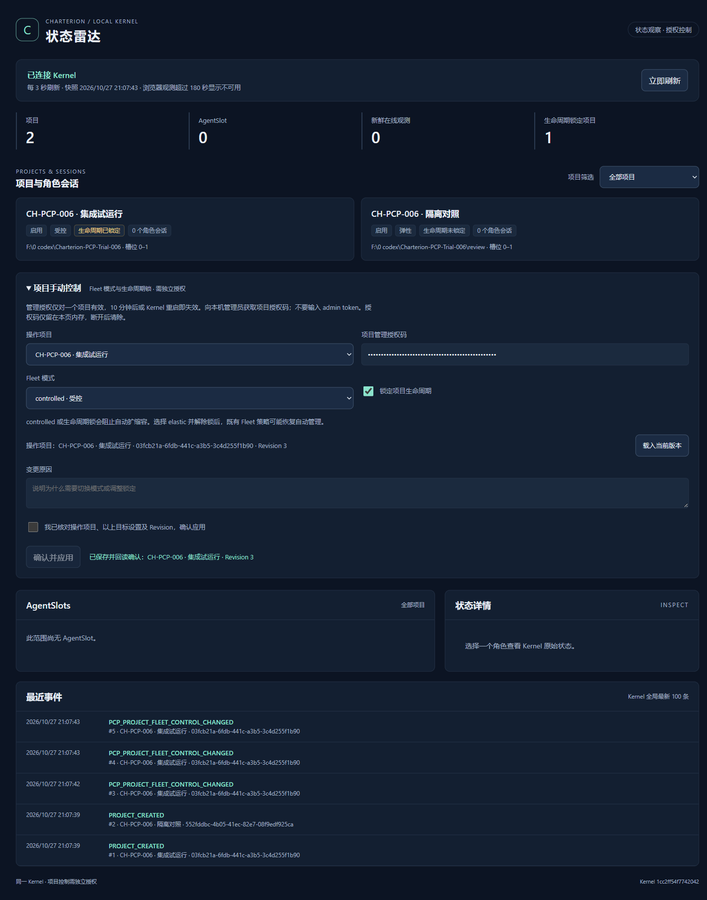

# CH-PCP-006：Charterion-PCP 集成试运行

输入：用户 CH-PCP-006，基于 Draft PR #8 `178529a291e2156795ad3db9fde2694b84f59e8d`。只建立独立 Windows 试运行实例，不改现有 Runtime、Profile、Host 注册或历史数据库；不接 CB、不扩展角色/任务、不合并 main。

## Architecture Gate（实现前完成）

沿用 PCP 主仓 `67fdf81a50fdd90f9c67d90d2f08706c3b669abc` 的 architecture-governance-gate、experience-reuse-gate、PCP-01 V0.2 FIXED、执行 profile 基线；本仓部署 V0.2 明确指出同名 Host 会被覆盖，要求独立身份后才能并行。本工单是该隔离约束的明确实施授权。

```yaml
architecture_gate:
  required: true
  status: complete
  real_use_evidence: verified
  decision: INTEGRATE
  pcp_specific_remainder: versioned isolated Windows trial installation and owned-process lifecycle
  minimum_formalization: narrow installer and lifecycle script around existing gam launcher/Kernel/Native protocol; no new service, authority or database
```

真实证据：CH-PCP-004/005 已实际验证雷达及管理链路，但仅有临时测试脚本；现有 installer 固定注册名并覆盖，不适用于用户要求的并行试运行。结构问题是可追溯交付与生命周期所有权，不是再造应用 Runtime。

Cross-Domain Scan: COMPLETE。

- 直接类比：[Chrome Native Messaging](https://developer.chrome.com/docs/extensions/develop/concepts/native-messaging) 的命名注册与 allowed_origins；保留协议，安装副本显式使用实例唯一 Host。
- 相邻领域：[.NET 部署](https://learn.microsoft.com/en-us/dotnet/core/deploying/) 的 self-contained 发布；复用现有 publish 脚本，不修改系统 SDK/Runtime。
- 结构类比：[Chrome 专用调试 Profile](https://developer.chrome.com/blog/remote-debugging-port) 隔离实际用户数据；使用专用 Chrome for Testing、独立 Profile 和仅回环的随机端口，不使用固定 9222 或宽泛 remote-allow-origins。

经验分类 PROJECT_LOCAL，复用已有安装/launcher 身份推导、Kernel、数据库和 Native 契约。Core-boundary impact: none。新脚本仅安装/启动/停止/诊断此工单实例，不引入服务、调度、任务或角色机制。

最小约束：安装目标必须不存在，拒绝覆盖；版本来自干净 Git SHA，记录复制后逐文件 SHA256 和显式 Host 替换；启动验证清单与注册；停止前核对精确进程路径/创建时间/实例，拒绝 PID 复用或外来进程。数据、Profile、凭据与版本产物分开；用户显式 start 才运行；测试结束停止，保留安装供一键重启。

## PR 依赖（当前远端核对）

| PR | base | head SHA |
| --- | --- | --- |
| #3 | main | f1ede68b9a9ea573bcbb7b81df30a8e6476c7344 |
| #4 | #3 分支 | 304c9dc4851e12201dbe11fe31d45dd8fbe07ca5 |
| #5 | #4 分支 | c5ac470bce713ebe7bfb525588a840d512839f51 |
| #6 | #5 分支 | bea8fc14b813169d5487b42228598935edb30fc8 |
| #7 | #6 分支 | 1c40e9b1282bd9bb7c4fdd6c65a5cb35742de493 |
| #8 | #7 分支 | 178529a291e2156795ad3db9fde2694b84f59e8d |

全部 OPEN/Draft，未合并；逐段祖先关系、构建及真实运行结果见下方验收记录。

## 可追溯版本与运行入口

PR #3→#4→#5→#6→#7→#8 的每一段 `git merge-base --is-ancestor` 均返回 0；本分支从 #8 继续，未合并 main。

最终安装版本：`fa42f6146ddff9d75a9271ab235d1bef5e6b8ed7`。后续提交只补验收文档/证据，不替换已测产物。独立安装根目录为 `F:\0 codex\Charterion-PCP-Trial-006`：

| 入口/文件 | 用途 |
| --- | --- |
| `PCP-Start.cmd` | 双击启动本实例 Kernel 与专用可见 Chrome；在插件点击“打开控制台”进入 HTML。已运行则返回 already-running，不重复拉起 |
| `PCP-Stop.cmd` | 仅停止记录且精确匹配路径、命令行、创建时间的本实例进程；保留数据和 Profile |
| `PCP-Diagnose.cmd` | 检查版本文件哈希、Host 注册、Node/Chrome 二进制哈希、Kernel 身份及浏览器进程；输出日志路径，结束等待按键 |
| `PCP-Control.cmd` | 为现有 gamctl 注入此实例的 GAM_HOME；提供签发项目短期管理码等原有 CLI 操作 |
| `trial.json` / `versions/<SHA>/release.json` | 实例身份、依赖二进制哈希、显式 Host 改写说明和安装文件 SHA256 清单 |
| `data` / `chrome-profile` / `data/logs` | 新数据/凭据、全新专用 Profile、Kernel 与 Chrome 启动日志；不纳入 Git |

实例 `1cc2ff54f7742042`；仅新增 HKCU Chrome Native Host `com.charterion.pcp_trial_1cc2ff54f7742042`，扩展 ID `kheifdlffdfcgmapmbbahdgkpccckmbn`。安装副本的 Host 名显式替换，源码协议名称不变；Native Host 与 Kernel 共用本实例管道及 browser.token，管理凭据仍由现有 Kernel 管理。HTTP/CDP 仅回环，随机端口，不能把本次端口写死为后续入口。

Native Host 使用便携 SDK 9.0.320 发布 net9.0/win-x64 self-contained 单文件，实际浏览器联调使用本次发布 EXE，SHA256 `8844c3b8f9cd7f665cdc308f7baa496b849f96a8752d37e4ca11ab473b6a10a5`。安装 release.json SHA256 `c1e324e05286c41fb431864173864158e1a8f4c22dbddb4f23efdbe2a7f8be19`。页面 JS 构建/HTTP SHA256 均为 `8e6b6824682024a9208cdbf576db9cbc6225e206893b5d211470ea2f1ac5ade6`，扩展 fingerprint `ad66bf685f749df1`。

Node `G:\docker\nodejs\node.exe`（24.14.0）和 Chrome for Testing 156.0.8078.47 `F:\0 codex\Charterion-PCP\.build-cache\CH-PCP-003\chrome-win64\chrome.exe` 作为已校验外部依赖保留；不要清理该 Chrome 缓存目录。Profile 不复用该缓存目录中的任何历史 Profile。此交付是本机可复启试运行实例，尚非不依赖工作区的便携发行包。

安装重现（须已完成构建，工作树干净；目标必须不存在）：

```powershell
node scripts/pcp-trial.mjs install --root 'F:\0 codex\Charterion-PCP-Trial-NEW' --chrome '.build-cache/CH-PCP-003/chrome-win64/chrome.exe' --native-dir dist-native-host
```

管理码仅在本机 CLI 签发，不把 admin token 放入 HTML；选择实际项目 ID 后：

```powershell
@{projectId='<project-id>';actor='local trial operator'} | ConvertTo-Json -Compress | & 'F:\0 codex\Charterion-PCP-Trial-006\PCP-Control.cmd' radar.authorize-control --admin --stdin
```

仅将返回的项目短期授权码输入页面；在页面核对 Revision、填写原因、确认提交。授权码到期或 Kernel 重启需重新签发。诊断异常时先查看 `data/logs/chrome-startup.log` 与 Kernel 日志；不通过旧 installer 重新注册或覆盖其他实例。停止脚本即使产物哈希损坏仍可执行，但始终核对进程所有权。

## 实际测试

| 检查 | 结果 | 本轮证据 |
| --- | --- | --- |
| Extension / Kernel 构建与类型检查 | PASS | `npm run build`、`build:control`、`check`、`check:control`、`check:dist`，最终安装源码再次构建通过 |
| Native .NET 构建/发布 | PASS | `npm run publish:native`，self-contained 发布；本次 EXE 经真实 Chrome Native Messaging 调用 Kernel 成功 |
| 架构/资源/文档/工作流检查 | PASS | check:architecture/assets/readme-i18n/deployment-docs/workflow-pinning；严格 README release 检查 PASS |
| 当前源码单元回归 | PASS | `npx vitest run --exclude '**/.build-cache/**' --pool=forks --fileParallelism=false`；87 文件、505 项，含新增 4 项安装保护测试 |
| Kernel / launcher / Fleet smoke | PASS | 现有 smoke-control、smoke-launcher、smoke-fleet 脚本 |
| 上游 Runtime ZIP 构建 | PASS | package:runtime；SHA256 `312b7e2e38205e7af1e5e60022a4ffa740f49d18cbedcf6f1394d6c7b14a6eab`。该旧格式 ZIP 不含本轮独立 installer，不当作本次试运行安装包 |
| 空数据/新 Profile 可见冷启动 | PASS | 2026-10-27 21:07:28→21:07:31 +08，实际调用 PCP-Start.cmd，exit 0，约 3.13 秒；此前无数据 DB/Preferences |
| 插件 → Native → 独立 HTML | PASS | 真实 Chrome 扩展页面点击共用“打开控制台”入口，Native 启动新 HTTP Tab，真实 Kernel 标识正确 |
| 真实状态刷新 | PASS | 空库先显示 0 项目；CLI 写入两个项目，页面自动刷新显示 2，测得 2979ms；无假数据 API |
| Fleet / 锁 / 审计 | PASS | UI controlled+锁定→elastic+解锁→controlled+锁定，Revision 1/2/3；每步成功后真实读回，另一项目 Revision 0；3 条 actor/原因审计 |
| 负例与重复提交 | PASS | 只读码写入 403、跨站 403；UI 双击每步仅一条审计 |
| 一键停止、重启与恢复 | PASS | PCP-Stop.cmd/PCP-Start.cmd 实际执行，原监听关闭，新 Chrome/Kernel PID 不同；Revision 3 controlled+锁定保持；插件重新打开显示 2 项目/1 锁定 |
| 重启撤销授权 | PASS | 旧 read 在新服务 401，旧项目授权配新 read 仍 403 |
| 重复启动与诊断 | PASS | 再次启动 already-running，PID 不变；实际执行 PCP-Diagnose.cmd，正常输出并保留退出码 |
| 产物损坏/外来 PID 保护 | PASS | 临时修改自有 radar.js 后 doctor/start 均拒绝；恢复原字节后哈希通过。将自有状态文件伪指向原 Runtime PID 5980，stop 拒绝且原 Runtime 存活；恢复状态文件 |
| 最终停止与原环境保护 | PASS | 本实例 Kernel/Chrome 全退；只保留一个交付 Host 注册，原 4 个值逐项一致；原 Runtime 5980 存活；历史 DB 长度 397312、精确 mtime 均不变（无测试前内容哈希，不声称内容哈希一致） |

真实数据仅为在本轮空库创建的两个项目，minSlots=0，无 AgentSlot/ChatGPT 会话。页面如实显示 0 AgentSlot；试运行留下 1 个锁定项目便于用户复启核验。这证明本次 Windows 安装、Native、雷达和项目控制链路，不延伸为角色执行或 ChatGPT 对话 E2E。



脱敏检查点：[验收结果 JSON](assets/CH-PCP-006-acceptance.json)。原始日志在 Git 忽略目录 `.build-cache/CH-PCP-006/`，包括 build-final.log、publish-native.log、unit-current-final.log、cold-start-final.json/log、acceptance-final.log、resume.log、protection.log、preservation-final.json、doctor-stopped.json。实际 read/control/admin 凭据、数据、Profile 不提交。

## 本轮修复及失败记录

1. PowerShell 5.1 的 CIM CreationDate 在 ConvertTo-Json 与 ConvertFrom-Json 间发生类型转换。最初 stop 的字符串比较错误拒绝了自有进程；保留路径/命令行等检查，改为毫秒时间比较，实际 stop/重启和外来 PID 拒绝均通过。
2. 初版试运行仅打开 about:blank；现有扩展启动会清理孤立空标签，关闭最后一个标签导致 Chrome 正常退出（退出码 0）。定位到 background.ts 的 closeOrphanBlankTabs 后，将独立入口改为 chrome://newtab/，不修改 Fleet/角色/任务行为，并保存 Chrome 启动 stderr。最终可见冷启动和多次重启通过。
3. 第一轮重启 harness 用同步 PowerShell 的管道捕获输出，收到 ready 后仍因继承管道超时；改为文件描述符收集输出，重新实际 stop/start 与后续完整断言通过。该失败运行保留，不冒充 PASS。
4. 未限定路径的 npm test 还发现了 .build-cache 中 CH-PCP-001 的历史源码：118 文件/643 项全通过。路径过滤同样匹配了缓存中的 tests/control/tests；最终以 --exclude '**/.build-cache/**' 明确排除旧副本，不将历史副本测试混入 505 项回执。

早期安装探针 `.build-cache/CH-PCP-006/install-smoke` 和 `F:\0 codex\Charterion-PCP-Trial` 已停止，仅移除了其精确匹配的新增 Host 注册，保留文件作断点证据。交付入口以本报告 Trial-006 目录为准。没有运行会覆盖固定 Host 的旧 installer/smoke-runtime-install。

## 未执行与风险

- NOT_RUN：本轮 ChatGPT 登录/收发、角色任务 E2E；没有新建角色或任务。物理鼠标点击工具栏图标未执行，实际点击扩展页面共用入口；工具栏入口沿用已有处理器。
- NOT_RUN：既有 Runtime 部署/原 Profile 联调、覆盖式旧 Runtime ZIP 安装 smoke、Edge/其他平台、断电/机器重启/多日浸泡和规模压力。冷启动是进程均不存在且初始空 DB/Profile 后启动，不等同于 Windows 重启。
- NOT_RUN：Hosted CI，远端 workflows=0；本地 PASS 不等同 CI PASS。
- 只读/管理授权仍属本机同一 Windows 用户的委托模型，不是多用户认证；管理码 10 分钟有效，页面内存保存，重启撤销。CDP 仅限回环且使用专用无历史登录 Profile，同机同用户仍可访问调试接口。
- Node 和便携 Chrome 为外部路径依赖且按二进制哈希校验；清理/更新它们会拒绝启动，需要重新验证并建立新版本，不应手动改清单绕过。没有系统服务或开机自动运行；本次结束已停止，保留用户手动一键启动能力。
- Chrome 初次启动日志含 sandbox 访问/网络服务重启提示，但实际渲染、Native 和后续控制通过；未禁用 sandbox、修改 ACL 或全局 Chrome 设置。便携 SDK 首次运行日志含开发证书生成提示，未执行 trust；缺少事前证书指纹，未删除可能既有的证书，也不声称证书状态经过回滚。

```yaml
execution_evidence:
  workorder_profile:
    recommended_model: null
    recommended_reasoning_effort: null
  selected_execution:
    actual_model: gpt-6.1-sol
    actual_reasoning_effort: NOT_EXPOSED_BY_RUNTIME
  resolution:
    type: runtime_unobservable
    reason: workorder omits execution_profile; runtime exposes model but not effort or selection provenance
  requested_by: user CH-PCP-006
  resolved_by: Codex desktop runtime
  actor: Codex
```

Tokdash 会话 `01a17c6a-87b5-7641-8c5e-e7d170079b63` 由 CH-PCP-001～006 共享（project-history-shared-session）。收尾采样 tokens=44449171、token_events=322，last_seen_at=2026-10-27T21:12:17.054+08:00；不是本工单独占用量。未创建额外任务跟踪体系。提交、Push、Draft PR 后停止。
